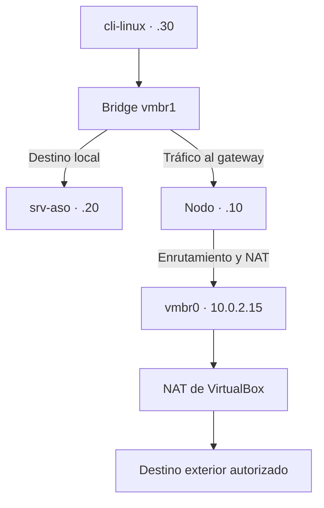

# Fase 2. Diseño de red

Modalidad: **B, Proxmox virtualizado en VirtualBox**. Nodo: `pve-saulean`.

## 1. Diseño general

| Elemento | Valor |
| --- | --- |
| Nombre del nodo Proxmox | `pve-saulean` |
| Interfaz de gestión | `vmbr0` (`10.0.2.15/24`, adaptador NAT de VirtualBox). Panel web en `https://127.0.0.1:8006` mediante reenvío de puertos |
| Bridge de salida | `vmbr0`, conectado al NAT de VirtualBox (gateway `10.0.2.2`) |
| Bridge de laboratorio | `vmbr1`, bridge interno sin puerto físico |
| Red de laboratorio | `192.168.0.0/24` (sin VLAN) |
| Gateway de las VMs/LXC | `192.168.0.10` (el nodo Proxmox, con enrutamiento y NAT) |
| DNS de las VMs/LXC | `8.8.8.8` |
| DNS del nodo | `10.0.2.3` (DNS del NAT de VirtualBox) |

## 2. Tabla de direccionamiento

| Elemento | Nombre | IP | Función | Recursos |
| --- | --- | --- | --- | --- |
| Nodo Proxmox | `pve-saulean` | `10.0.2.15/24` (vmbr0) y `192.168.0.10/24` (vmbr1) | Hipervisor, gateway y NAT del laboratorio | 2 vCPU, 6-8 GB RAM, 80 GB (según Fase 1) |
| Servidor ASO | `srv-aso` | `192.168.0.20/24` | Servicio principal (Samba con ACL) | 1-2 vCPU, 1-2 GB RAM |
| Cliente | `cli-linux` | `192.168.0.30/24` | Pruebas | 1 vCPU, 512 MB-1 GB RAM |

## 3. Diagrama de red

Recorrido del tráfico:

- **Cliente a servidor:** `cli-linux` y `srv-aso` están en la misma subred, así que hablan directamente por `vmbr1` sin pasar por el nodo.
- **Hacia Internet:** el tráfico va al gateway `192.168.0.10`. El nodo lo reenvía y lo traduce con NAT (masquerade) por `vmbr0`, y el NAT de VirtualBox lo saca al exterior.

## 4. Gestión del nodo

El adaptador NAT de VirtualBox no permite conexiones entrantes, así que se configura un reenvío de puertos en la VM (Red > Adaptador NAT > Reenvío de puertos):

| Nombre | Protocolo | IP anfitrión | Puerto anfitrión | IP invitado | Puerto invitado |
| --- | --- | --- | --- | --- | --- |
| proxmox-web | TCP | `127.0.0.1` | 8006 | `10.0.2.15` | 8006 |
| proxmox-ssh | TCP | `127.0.0.1` | 2222 | `10.0.2.15` | 22 |

Se limita a `127.0.0.1` para que solo mi equipo pueda acceder al panel y al SSH, y no el resto de dispositivos de la wifi.

## 5. Puertos necesarios

| Origen | Destino | Puerto | Uso |
| --- | --- | --- | --- |
| Mi equipo (127.0.0.1) | Nodo | 8006/tcp | Panel web de Proxmox |
| Mi equipo (127.0.0.1) | Nodo | 22/tcp (vía 2222) | SSH de administración |
| `cli-linux` | `srv-aso` | 445/tcp | Samba (SMB) |
| `cli-linux` | `srv-aso` | 22/tcp | SSH y Ansible |
| `cli-linux` | `srv-aso` | ICMP | Pruebas de conectividad (`ping`) |
| VMs del laboratorio | Internet (vía nodo) | 53/udp-tcp, 80/tcp, 443/tcp | DNS y actualizaciones con `apt` |

No se abren 139/tcp ni 137-138/udp (NetBIOS) porque el servicio no los necesita.

## 6. Medidas de aislamiento y permisos

- **Aislamiento de red:** `vmbr1` no tiene puerto físico asociado. Las máquinas del laboratorio solo se ven entre sí y con el nodo, y salen al exterior únicamente por NAT.
- **Sin acceso entrante:** no hay reenvío de puertos hacia las VMs; desde fuera no se puede llegar a `srv-aso` ni a `cli-linux`.
- **Gestión restringida:** el panel y el SSH del nodo solo se alcanzan desde `127.0.0.1` de mi equipo gracias al reenvío limitado a localhost.
- **Firewall de Proxmox:** política de entrada restrictiva y permitir solo los puertos de la tabla anterior (se configura en la Fase 4).
- **Permisos:** SSH sin acceso directo de root en las VMs, usuario administrativo con `sudo`, acceso a Samba solo para `@grupo_asir`.
- **Pruebas de seguridad:** solo desde `cli-linux` contra `srv-aso`, dentro del laboratorio autorizado.
- **Secretos:** contraseñas y claves fuera del repositorio.

## 7. Justificación

Separar salida (`vmbr0`) y laboratorio (`vmbr1`) evita que el servicio quede expuesto a la red del equipo o de la wifi. El nodo actúa de único punto de paso, lo que permite controlar y registrar el tráfico. Al ser una red pequeña y de un solo segmento, el aislamiento con un bridge interno es suficiente y no hace falta VLAN.

## 8. Evidencias

- Diagrama Mermaid de este documento.
- Tabla de direccionamiento.
- Justificación de aislamiento y permisos.
- Capturas de la configuración del NAT y reenvío de puertos en VirtualBox y de la red en Proxmox (se añadirán tras la Fase 3).
